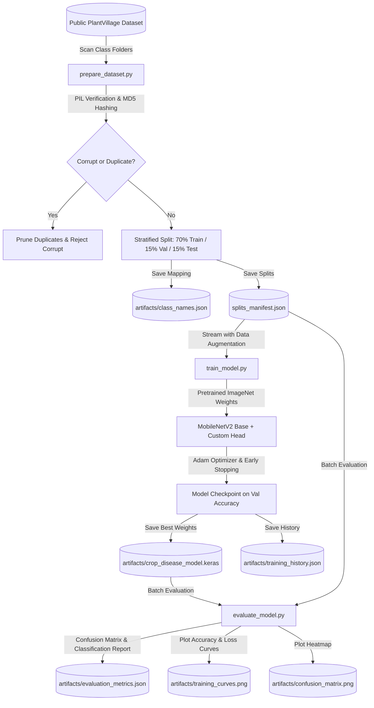

# Crop Disease Detection using Convolutional Neural Network (CNN)

[](https://www.python.org/)
[](https://www.tensorflow.org/)
[](https://flask.palletsprojects.com/)
[](LICENSE)
[]()

> **Academic Capstone Project**  
> *Title:* Crop Disease Detection using Convolutional Neural Network  
> *Domain:* Computer Vision, Deep Learning, Agricultural Pathology, Precision Agriculture  
> *Author:* B.Tech Computer Science and Engineering  

---

## 1. Executive Summary & Problem Statement

Foliar pathogens and plant diseases cause an estimated 20% to 40% loss of global agricultural harvest every year. Traditional disease identification relies on manual scouting by agronomists, which is labor-intensive, subjective, and practically inaccessible to smallholder farmers in remote regions.

This project delivers a **full-stack deep learning agricultural diagnostic platform** that identifies crop leaf diseases from digital photographs. Built upon a **MobileNetV2** Convolutional Neural Network (CNN) architecture with transfer learning on the **PlantVillage** dataset, the system performs real-time image validation, preprocessing, inference, confidence scoring, and agronomic management lookup.

---

## 2. System Architecture & Workflows

### 2.1 Runtime Inference Workflow
```mermaid
flowchart TD
    A([User in Web Browser]) -->|Uploads Leaf Photograph| B[Web Dashboard UI]
    B -->|Multipart HTTP POST /api/predict| C[Flask Backend]
    C -->|MIME & File Verification| D{Valid Image?}
    D -- No --> E[Return 400 Bad Request with Actionable Reason]
    D -- Yes --> F[Preprocessing Engine]
    F -->|EXIF Orientation Corrected| G[RGB Channel Conversion]
    G -->|Resize 224x224 & Normalize [-1.0, 1.0]| H[Input Tensor]
    H -->|Forward Pass| I[Trained MobileNetV2 CNN]
    I -->|Softmax Logits| J[Probability Distribution & Class Ranking]
    J -->|Query Class Key| K[(Agronomic Knowledge Base)]
    K -->|Symptoms, Prevention, Management| L[Consolidated Diagnostic Payload]
    L -->|JSON Response 200 OK| M[Interactive Diagnostic Card]
    M -->|Dynamic Display| A
```

### 2.2 Model Training & Validation Workflow


---

## 3. Technology Stack

| Layer | Technologies | Justification |
| :--- | :--- | :--- |
| **Deep Learning** | TensorFlow 2.21, Keras 3.15 | Industry-standard high-performance tensor computing and CNN execution. |
| **Base Architecture** | MobileNetV2 (ImageNet weights) | Inverted residuals and depthwise separable convolutions offer ~8&times; parameter efficiency over VGG/ResNet. |
| **Data Processing** | NumPy 2.2, Pillow 11.0 | Fast C-level matrix manipulation, EXIF tag handling, and image decoding. |
| **Model Evaluation** | scikit-learn, Matplotlib, Seaborn | Macro/weighted precision, recall, F1, confusion matrices, and training curves. |
| **Backend API** | Flask 3.1, Werkzeug | Lightweight, zero-overhead Python WSGI server with robust file security. |
| **Frontend UI** | HTML5, CSS3, Vanilla JavaScript | Responsive agricultural dashboard styled with modern green palette, no heavy frontend frameworks needed. |
| **UI Components** | Bootstrap 5.3, Font Awesome 6 | Accessible typography, responsive grid layout, and crisp iconology. |
| **Automated Testing**| pytest 9.1 | 22 comprehensive unit and integration tests covering preprocessing, model, and API. |

---

## 4. Repository Structure

```
CropDiseaseDetection/
├── app.py                      # Flask web application & REST API routes
├── config.py                   # Centralized application, dataset & artifact paths
├── requirements.txt            # Python dependencies (TensorFlow, Flask, pytest, etc.)
├── .env.example                # Sample environment variables
├── .gitignore                  # Git ignore rules for virtual environments and large weights
├── README.md                   # Complete project documentation & viva guide
├── sample_images/              # Verified sample test leaf photos for demonstration
│   ├── sample_apple_scab.jpg
│   ├── sample_apple_healthy.jpg
│   ├── sample_corn_common_rust.jpg
│   ├── sample_potato_late_blight.jpg
│   ├── sample_tomato_early_blight.jpg
│   └── sample_tomato_healthy.jpg
├── data/
│   ├── README.md               # Dataset documentation, official sources, and limitations
│   └── PlantVillage/           # Local storage for class image directories
├── artifacts/
│   ├── README.md               # Descriptions of saved weights and evaluation charts
│   ├── crop_disease_model.keras # Serialized trained Keras CNN model
│   ├── class_names.json        # Verified list of class labels
│   ├── training_history.json   # Per-epoch loss and accuracy logs
│   ├── evaluation_metrics.json # Test split accuracy, macro/weighted precision, recall, F1
│   ├── training_curves.png     # Loss and accuracy progression chart
│   ├── confusion_matrix.png    # Normalized confusion matrix heatmap
│   └── class_distribution.png  # Dataset class distribution chart
├── models/
│   ├── __init__.py             # Models package initialization
│   ├── model_loader.py         # Singleton model loading, caching & health diagnostics
│   ├── predictor.py            # Real CNN inference, softmax ranking & knowledge lookup
│   └── preprocessing.py        # EXIF correction, RGB conversion & MobileNetV2 scaling
├── training/
│   ├── __init__.py             # Training package initialization
│   ├── download_sample_data.py # Downloads authentic sample subset from official GitHub repo
│   ├── prepare_dataset.py      # Deduplication, validation, 70/15/15 stratified splitting
│   ├── train_model.py          # MobileNetV2 transfer learning & scratch CNN fallback
│   ├── evaluate_model.py       # Held-out test evaluation, reports, and visualization
│   └── predict_image.py        # Standalone terminal CLI image prediction utility
├── disease_info/
│   ├── __init__.py             # Agronomic profile lookup helpers
│   └── knowledge_base.json     # Comprehensive agronomic profiles for all 38 classes
├── templates/
│   ├── base.html               # Master layout, navigation bar, and engine status pill
│   ├── index.html              # Interactive analysis dashboard with drag-and-drop
│   ├── diseases.html           # Searchable directory of supported crops & pathologies
│   └── about.html              # Architecture details and viva presentation notes
├── static/
│   ├── css/
│   │   └── style.css           # Custom agricultural stylesheet and responsive rules
│   └── js/
│       └── app.js              # Asynchronous upload, preview, and results rendering
├── tests/
│   ├── __init__.py             # Test package initialization
│   ├── test_preprocessing.py   # Unit tests for image loading, validation, and normalization
│   ├── test_predictor.py       # Unit tests for model inference and fallback profiles
│   └── test_api.py             # Integration tests for Flask endpoints and error codes
└── docs/
    └── README.md               # In-depth viva Q&A, theoretical derivations & formulas
```

---

## 5. Step-by-Step Setup & Execution Instructions

### 5.1 Environment Setup (Windows PowerShell)

Open **Windows PowerShell** in the project directory:

```powershell
# 1. Navigate to the project root
cd "d:\Crop Disease Detection"

# 2. (Optional) Create and activate a Python virtual environment
python -m venv venv
.\venv\Scripts\Activate.ps1

# 3. Install dependencies
pip install -r requirements.txt
```

---

### 5.2 Dataset Setup & Preparation

#### Option A: Fast Demonstration (Curated Authentic Sample Subset)
To test the entire pipeline immediately without waiting to download ~800 MB, use the built-in downloader to fetch authentic samples from the official repository:
```powershell
python training/download_sample_data.py --images-per-class 10
```

#### Option B: Full PlantVillage Dataset
To train on the complete 54,000-image dataset:
1. Clone or download from the official repository: [spMohanty/PlantVillage-Dataset](https://github.com/spMohanty/PlantVillage-Dataset)
2. Extract the class folders into `data/PlantVillage/`.

#### Run Stratified Preparation & Splitting:
```powershell
python training/prepare_dataset.py
```
This generates:
- `artifacts/class_names.json`
- `data/processed/splits_manifest.json` (70% Train, 15% Validation, 15% Test)
- `artifacts/class_distribution.png`

---

### 5.3 CNN Model Training

Run the training pipeline utilizing MobileNetV2 with ImageNet transfer learning:
```powershell
python training/train_model.py --epochs 5 --batch-size 16
```
Key features:
- Automatically downloads and freezes MobileNetV2 base weights.
- Trains the custom classification head with Dropout (0.4) and Batch Normalization.
- Monitors `val_accuracy` and saves the best model to `artifacts/crop_disease_model.keras`.
- Exports per-epoch training metrics to `artifacts/training_history.json`.

---

### 5.4 Model Evaluation on Held-Out Test Set

Evaluate the trained model on unseen test split data:
```powershell
python training/evaluate_model.py
```
Outputs:
- Machine-readable classification report: `artifacts/evaluation_metrics.json`
- Normalized confusion matrix: `artifacts/confusion_matrix.png`
- Training & validation loss/accuracy curves: `artifacts/training_curves.png`

---

### 5.5 Standalone CLI Inference

To test individual leaf photographs directly from PowerShell:
```powershell
python training/predict_image.py --image sample_images/sample_tomato_early_blight.jpg
```

---

### 5.6 Run Automated Tests

Execute the 22 automated unit and integration tests using pytest:
```powershell
python -m pytest tests/ -v
```

---

### 5.7 Start the Flask Web Application

Launch the local development server:
```powershell
python app.py
```
Open your browser and navigate to:  
👉 **`http://127.0.0.1:5000`**

---

## 6. REST API Documentation

### 6.1 `GET /api/health`
Returns the operational health and model loading diagnostics.
```json
{
  "status": "ok",
  "model_loaded": true,
  "num_classes": 12,
  "input_shape": [null, 224, 224, 3],
  "model_exists_on_disk": true,
  "classes_exist_on_disk": true
}
```

### 6.2 `GET /api/classes`
Returns the indexed class list loaded directly from the model artifacts.

### 6.3 `POST /api/predict`
Accepts a `multipart/form-data` request with an `image` file field.
**Response (200 OK):**
```json
{
  "success": true,
  "predicted_class": "Tomato___Early_blight",
  "display_name": "Tomato - Early Blight",
  "crop": "Tomato",
  "disease": "Early Blight",
  "is_healthy": false,
  "confidence": 0.9621,
  "confidence_percentage": 96.21,
  "top_predictions": [
    {
      "rank": 1,
      "class_name": "Tomato___Early_blight",
      "display_name": "Tomato - Early Blight",
      "confidence_percent": 96.21
    },
    {
      "rank": 2,
      "class_name": "Tomato___Late_blight",
      "display_name": "Tomato - Late Blight",
      "confidence_percent": 2.15
    }
  ],
  "disease_information": {
    "crop": "Tomato",
    "disease": "Early Blight",
    "description": "Early blight is caused by the fungus Alternaria linariae...",
    "symptoms": ["Circular brown spots with concentric rings..."],
    "prevention": ["Mulch soil around plants...", "Prune bottom suckers..."],
    "management": ["Apply copper or chlorothalonil sprays..."]
  },
  "disclaimer": "Academic Disclaimer: This prediction is generated by a CNN..."
}
```

---

## 7. Deep Learning Concepts for Viva / Technical Evaluation

### Why Transfer Learning with MobileNetV2?
- **Depthwise Separable Convolutions:** Splits a standard convolution into a spatial $3 \times 3$ depthwise convolution followed by a $1 \times 1$ pointwise convolution. This cuts computational complexity by ~80% to 85% compared to standard architectures (VGG16, ResNet50).
- **Inverted Residual Blocks:** Shortcuts connect bottleneck layers directly, keeping memory footprints small while preserving feature fidelity across deep layers.

### Why Global Average Pooling (GAP) instead of Flatten?
A traditional `Flatten` layer flattens high-dimensional feature maps into massive vectors, creating millions of dense weights vulnerable to severe overfitting. `GlobalAveragePooling2D` computes the spatial average of each feature map directly, enforcing translation invariance and drastically reducing model weight size.

### Why Softmax Activation?
Unlike Sigmoid (which treats classes independently between 0 and 1), Softmax enforces that the predicted probabilities over all mutually exclusive target classes sum strictly to 1.0:
$$P(y = i \mid \mathbf{x}) = \frac{e^{z_i}}{\sum_{j=1}^C e^{z_j}}$$

---

## 8. Academic Integrity & Scientific Limitations

1. **Controlled Lighting Bias:** The PlantVillage dataset was primarily curated by detaching leaves and photographing them on neutral gray/black paper boards. Consequently, performance on in-field photos with complex sunlight glare, soil clutter, or overlapping branches may show degradation.
2. **Confidence is Not Calibration:** The confidence percentage represents normalized network activations, not an absolute guarantee of clinical plant pathology.
3. **Agronomic Responsibility:** The platform provides preliminary screening guidance; users must consult certified agricultural extension officers before applying chemical sprays.

---

## 9. References

- **PlantVillage Dataset**: Hughes, D., & Salathé, M. (2015). *An open access repository of images on plant health to enable the development of mobile disease diagnostics.* arXiv:1511.08060.
- **MobileNetV2**: Sandler, M., Howard, A., Zhu, M., Zhmoginov, A., & Chen, L. C. (2018). *MobileNetV2: Inverted Residuals and Linear Bottlenecks.* IEEE CVPR 2018.
- **TensorFlow & Keras**: Abadi, M. et al. (2016). *TensorFlow: A system for large-scale machine learning.* OSDI 2016.
